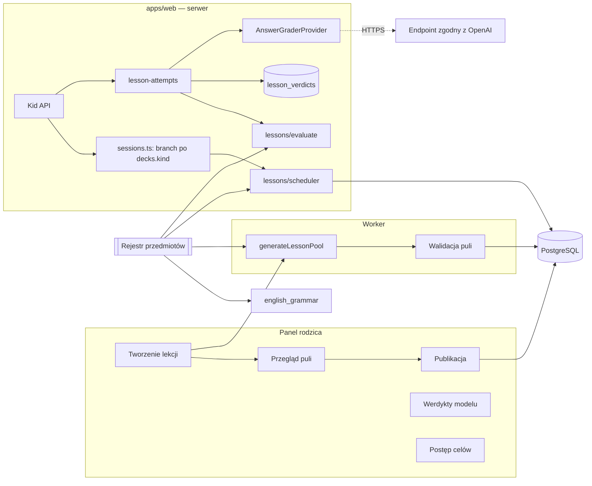

# Design — silnik lekcji z modułami przedmiotów (pierwszy: gramatyka angielska)

Źródło wymagań: `requirements.md` w tym katalogu. Kontekst: `docs/SPEC.md` 1.1, `docs/architecture.md` 1.2, `docs/folder-structure.md`, kod `packages/server` (`db/schema.ts`, `modules/attempts.ts`, `sessions.ts`, `events.ts`, `mock-tests.ts`, `published-progress.ts`, `learning-overview.ts`, `kid.ts`, `progress-rebuild.ts`).

## Overview

Moduł dodaje nowy rodzaj zestawu — **lekcję** — obok zestawów słówek. Lekcja należy do **przedmiotu** (subject), dotyczy **tematu** i uczy **celów nauki** (objectives). Pierwszy przedmiot to gramatyka angielska: temat = czas/konstrukcja (Present Simple), cel = reguła („-s w 3. osobie”). Docelowo te same mechanizmy obsłużą historię, biologię czy geografię (temat = rozdział, cel = fakt/pojęcie/związek przyczynowy), dlatego:

1. **Silnik lekcji jest niezależny od przedmiotu.** Typy ćwiczeń, ocena, postęp per cel, selektor zadań, pula, kartkówka, kontrakty i widoki dziecka nie znają ani angielskiego, ani gramatyki.
2. **Przedmiot to wtyczka (`SubjectModule`) za interfejsem** (Strategy + Registry, Open/Closed): dostarcza katalog tematów i celów, dozwolone typy ćwiczeń, normalizator odpowiedzi, kategorie błędów, profil promptów generacji i oceny oraz walidatory specyficzne dla przedmiotu. Dodanie przedmiotu = nowy katalog `subjects/<id>/` i jeden wpis w rejestrze.
3. **Postęp liczymy per cel, nie per zadanie.** Każde ćwiczenie sprawdza dokładnie jeden cel. Niezależne sprawdzenie zawsze używa ćwiczenia, którego odpowiedź nie była dziecku ujawniona.
4. **Pula ćwiczeń jest generowana przy przygotowaniu i zatwierdzana przez rodzica.** Sesja wybiera z puli; nic nie jest generowane w trakcie nauki.
5. **Ocena hybrydowa.** Dopasowanie deterministyczne (normalizator przedmiotu, tolerancja drobnej literówki poza elementem sprawdzanym) → zapisany werdykt → model oceniający zgodny z OpenAI. Awaria modelu = „nieocenione”, bez kary.
6. **Reużycie istniejących mechanizmów z jawnymi punktami rozszerzenia.** Dziś kod nie rozróżnia rodzaju zestawu (`sessions.ts`, `attempts.ts`, `mock-tests.ts`, `published-progress.ts`, `learning-overview.ts` nie czytają `decks.kind`), więc moduł wprowadza te rozgałęzienia jako nową pracę.

Zakres wersji pierwszej: przedmiot `english_grammar` z tematem Present Simple; cele pochodzą z katalogu (ręcznie napisane reguły). Interfejs `SubjectModule` przewiduje w przyszłości cele wyprowadzane z materiału (np. historia), ale ta ścieżka nie jest implementowana. Ćwiczenia wielocelowe i alternatywne porządki klocków są poza tą wersją.

Słownik nazw w kodzie (UI rodzica/dziecka pozostaje po polsku, „Gramatyka”, „reguła” w przedmiocie gramatyki):

| Pojęcie | Kod |
| --- | --- |
| Lekcja (rodzaj zestawu) | `decks.kind = 'lesson'` |
| Ćwiczenie lekcji | `learning_items.kind = 'lesson_exercise'` |
| Przedmiot | `SubjectModule`, `subjectId` (np. `english_grammar`) |
| Temat | `LessonTopic`, `topicId` (np. `present_simple`) |
| Cel nauki (reguła gramatyki) | `LearningObjective`, `objectiveId` |
| Umiejętność oceny | kod `objective` w rejestrze `SKILLS` |

## Architecture



Rozmieszczenie kodu (zgodne z granicami `folder-structure.md`):

| Ścieżka | Zawartość |
| --- | --- |
| `packages/server/src/domain/lessons/types.ts` | `SubjectModule`, `LessonTopic`, `LearningObjective`, `ErrorCategory`, `LessonExerciseType`, `LessonStage`, `AnswerNormalizer` |
| `packages/server/src/domain/lessons/registry.ts` | Rejestr przedmiotów (`getSubject`, `listSubjects`, `getTopic(subjectId, topicId, version)`) |
| `packages/server/src/domain/lessons/catalog-validation.ts` | `validateSubject(module)` — ogólne reguły spójności |
| `packages/server/src/domain/lessons/base-error-categories.ts` | Kategorie wspólne dla wszystkich przedmiotów (`other`, `incomplete`, `wrong_order`) |
| `packages/server/src/domain/lessons/normalize.ts` | Bazowy normalizator tekstu (NFC, apostrofy, wielkość liter, interpunkcja, tokenizacja) |
| `packages/server/src/domain/lessons/evaluate.ts` | Dopasowanie, tolerancja literówki, walidacja i interpretacja werdyktu |
| `packages/server/src/domain/lessons/progress.ts` | Kwalifikacja niezależności i projekcja per cel |
| `packages/server/src/domain/lessons/scheduler.ts` | Selektor zadań lekcji |
| `packages/server/src/domain/lessons/pool-validation.ts` | Walidacja ćwiczeń (ogólna + walidatory przedmiotu) |
| `packages/server/src/domain/lessons/mock-test-plan.ts` | Plan kartkówki lekcji |
| `packages/server/src/domain/lessons/subjects/english-grammar/` | `module.ts` (rejestracja), `normalizer.ts` (skróty angielskie), `error-categories.ts`, `validators.ts`, `prompts.ts`, `topics/present-simple.ts` |
| `packages/server/src/modules/lessons/` | `lesson-drafts.ts` (tworzenie, generowanie, przegląd, publikacja), `lesson-sessions.ts`, `lesson-attempts.ts`, `lesson-verdicts.ts`, `lesson-progress.ts`, `lesson-mock-tests.ts` |
| `packages/server/src/ports/ai.ts` | `AnswerGraderProvider`, `LlmProvider.generateLessonPool` |
| `packages/server/src/providers/openai-compatible/grader.ts` | Adapter modelu oceniającego |
| `packages/contracts/src/lessons.ts` | DTO lekcji, ćwiczeń, postępu celów, werdyktów, raportu kartkówki |
| `packages/kid-ui/src/exercises/lesson/` | Widoki ćwiczeń lekcji |
| `apps/web/src/parent/lessons/` | Formularz lekcji, przegląd puli, werdykty, postęp |

Domena nie importuje SDK, bazy ani zegara. Silnik (`domain/lessons/*.ts` poza `subjects/`) nie importuje niczego z `subjects/` — zależność biegnie tylko przez rejestr i interfejs (test architektoniczny sprawdza importy).

### Punkty rozszerzenia w istniejącym kodzie (nowa praca)

| Miejsce | Zmiana |
| --- | --- |
| `modules/sessions.ts` (`startSession`, `nextTask`, `endSession`) | Odczyt `decks.kind`; dla `lesson` delegacja do `modules/lessons/lesson-sessions.ts` (selektor, budowa promptów, podsumowanie) |
| `modules/attempts.ts` (`submitAttempt`, zbiory `CHOICE_EXERCISES` / `WRITTEN_EXERCISES` / `RECALL_LIKE`, `nextTaskState`) | Delegacja zadań `lesson_*` do `lesson-attempts.ts`; reużycie idempotencji, `request_hash`, blokady sesji, rezerwacji `processing`, leniwej finalizacji i `dbOutcome` |
| `modules/events.ts` (`authorizeDisclosure`) | Odsłuch w zadaniach tekstowych lekcji = wsparcie; podpowiedź niedostępna w kartkówce |
| `modules/mock-tests.ts` | Dla `lesson` plan z `domain/lessons/mock-test-plan.ts`, raport per cel |
| `modules/published-progress.ts`, `modules/reporting.ts` | Odrzucenie (`deck_kind_mismatch`) lub pominięcie lekcji |
| `modules/learning-overview.ts` | Filtr `decks.kind = 'vocabulary'` we wszystkich odczytach |
| `modules/kid.ts` (`listKidDecks`) | `KidDeckDto.kind`, `subjectTitle`; gwiazdki lekcji z opanowanych celów |
| `modules/progress-rebuild.ts` | Odbudowa także `child_objective_progress` |
| `modules/profiles.ts` (`deleteChild`) | Kaskada obejmuje nowe tabele per dziecko |

Wspólne fragmenty, które dziś są wewnątrz `attempts.ts`/`sessions.ts` i są potrzebne lekcjom (blokada, rezerwacja `processing`, zapis ekspozycji, idempotencja), wydzielamy do funkcji eksportowanych z obecnych modułów zamiast je duplikować. Testy regresji słówek chronią każdy z tych punktów.

## Components and Interfaces

### Przedmiot i katalog (`domain/lessons/types.ts`)

```ts
type ErrorCategoryCode = string;            // walidowany rejestrem przedmiotu

interface ErrorCategory { code: ErrorCategoryCode; labelPl: string }

interface LearningObjective {
  id: string;                               // "english_grammar.present_simple.third_person_s"
  titlePl: string;                          // „-s w 3. osobie”
  descriptionEn: string;                    // opis dla promptów generacji i oceny
  cards: { title: string; body: string }[]; // 2–4 karty po polsku; {{examples}} = przykłady z lekcji
  errorCategories: ErrorCategoryCode[];
  hints: Record<ErrorCategoryCode, string>; // szablon podpowiedzi po polsku dla każdej kategorii celu
  exerciseTypes: LessonExerciseType[];
}

interface LessonTopic {
  id: string;                               // "present_simple"
  version: number;                          // rośnie przy zmianie; stare wersje zostają w rejestrze
  titlePl: string;
  extraErrorCategories: ErrorCategory[];
  transforms: { id: string; instructionPl: string }[];
  objectives: LearningObjective[];          // w kolejności nauki
}

interface AnswerNormalizer {
  /** Zbiór równoważnych sekwencji tokenów (np. rozwinięcia skrótów). */
  normalize(text: string): string[][];
}

interface SubjectModule {
  id: string;                               // "english_grammar"
  titlePl: string;                          // „Angielski — gramatyka”
  answerLocale: string;                     // "en-GB" — język odpowiedzi dziecka
  promptLocale: string;                     // "pl-PL" — język poleceń
  exerciseTypes: LessonExerciseType[];      // typy wspierane przez przedmiot
  errorCategories: ErrorCategory[];         // kategorie przedmiotu (poza bazowymi)
  normalizer: AnswerNormalizer;
  topics: LessonTopic[];                    // wszystkie wersje tematów
  prompts: SubjectPromptProfile;            // fragmenty promptów generacji i oceny
  validateExercise(ex: LessonExerciseDraft, topic: LessonTopic): string[]; // błędy specyficzne dla przedmiotu
  ttsForAnswers: boolean;                   // czy generować audio odpowiedzi kanonicznej
}

interface SubjectPromptProfile {
  generationRole: string;                   // opis roli autora ćwiczeń dla tego przedmiotu
  gradingRole: string;                      // co ocenia model (zastosowanie celu, nie styl)
  almostDefinition: string;                 // kiedy werdykt „almost”
}
```

`validateSubject(module)` (test jednostkowy dla każdego zarejestrowanego przedmiotu): unikalne `id` tematów, celów, kategorii i przekształceń; kategorie celu istnieją w zbiorze bazowym, przedmiotu lub tematu; każda kategoria celu ma szablon podpowiedzi; 2–4 karty; co najmniej jeden typ z każdego etapu ocenianego; typy celu ⊆ typy przedmiotu; `lesson_transform` tylko w tematach z niepustym `transforms`. Test z przedmiotem testowym (fixture „history-like”: bez normalizatora skrótów, z typami `choice`/`order`/`gap`/`open_answer`, z własną kategorią) dowodzi, że silnik nie zakłada angielskiego.

### Typy ćwiczeń i etapy (ogólne)

```ts
type LessonExerciseType =
  | "lesson_card" | "lesson_notice" | "lesson_choice" | "lesson_order"
  | "lesson_short_answer" | "lesson_gap" | "lesson_error_fix"
  | "lesson_transform" | "lesson_open_answer";

type LessonStage = "intro" | "guided" | "productive" | "independent";
```

| Typ | Etap | Kid prompt | Odpowiedź (modality) | Ocena | Przykład gramatyka / historia |
| --- | --- | --- | --- | --- | --- |
| `lesson_card` | intro | `{ title, body, examples[] }` | „Dalej” (`complete-presentation`) | brak | karta reguły / karta pojęcia |
| `lesson_notice` | intro | `{ instructionPl, segments: { id, text }[][] }` | `choice` (id segmentu) | id; wsparcie `options` | „Dotknij słowa, które się zmienia” |
| `lesson_choice` | guided | `{ instructionPl, stem, options[] }` | `choice` | id | forma czasownika / data bitwy |
| `lesson_order` | guided | `{ instructionPl, items: {id,text}[] }` (potasowane) | `sequence` | sekwencja == kanoniczna | klocki zdania / chronologia |
| `lesson_short_answer` | guided | `{ question, options[] }` | `choice` | id | *Yes, he does* / Tak/Nie |
| `lesson_gap` | productive | `{ instructionPl, stemWithGap, hint? }` | `text` | tekst | *He ___ (play)* / „Mieszko I przyjął chrzest w ___” |
| `lesson_error_fix` | productive | `{ instructionPl, statement }` | `text` | tekst | popraw błąd w zdaniu / w fakcie |
| `lesson_transform` | productive | `{ instructionPl, statement }` | `text` | tekst | zamień na przeczenie |
| `lesson_open_answer` | independent | `{ instructionPl, prompt }` | `text` | tekst | „Przetłumacz: …” / „Dlaczego …?” |

`instructionPl` pochodzi z payloadu ćwiczenia (generowany i zatwierdzany przez rodzica) albo z katalogu (polecenia przekształceń). Typy produktywne wydane na ćwiczeniu niewidzianym są dla selektora zadaniami etapu samodzielnego. Typy etapu prowadzonego mają wsparcie `options`, więc nie kwalifikują się jako niezależne zastosowanie celu; liczą się do awansu etapów.

Karta `lesson_card` ma własny `exercise_type`; migracja rozszerza CHECK `session_tasks_completed_only_exposure` do `exercise_type in ('exposure','lesson_card')`, a `complete-presentation` akceptuje oba typy.

Kid DTO nigdy nie zawiera odpowiedzi, wariantów, elementu sprawdzanego, celu ani kategorii.

### Normalizacja

Bazowy normalizator (`domain/lessons/normalize.ts`, ogólny): NFC, przycięcie, ujednolicenie apostrofów (`’ ‘ ʼ ´` → `'`), lowercase, usunięcie interpunkcji poza apostrofem wewnątrz słowa, zwinięcie spacji, tokenizacja. Zwraca jedną sekwencję.

Normalizator przedmiotu `english_grammar` (`subjects/english-grammar/normalizer.ts`) dekoruje bazowy (Decorator): po kroku bazowym rozwija skróty angielskie z zamkniętej tabeli (`don't→do not`, `doesn't→does not`, `didn't→did not`, `isn't→is not`, `aren't→are not`, `wasn't→was not`, `weren't→were not`, `haven't→have not`, `hasn't→has not`, `won't→will not`, `can't→cannot | can not`, `I'm→I am`, `you're/we're/they're→… are`, `it's/he's/she's→… is | … has`, `I've/…→… have`, `I'll/…→… will`, `I'd/…→… would | … had`) oraz formy bez apostrofu (`doesnt`, `dont`, `isnt`). Wynik: zbiór wariantów sekwencji tokenów. Tabela należy do przedmiotu, nie silnika.

### Ocena (`domain/lessons/evaluate.ts`)

```ts
interface LessonAnswerKey {
  exerciseType: LessonExerciseType;
  objectiveId: string;
  answer: string;
  acceptedAnswers: string[];
  focus: string[];               // tokeny elementu sprawdzanego w odpowiedzi kanonicznej (normalizowane normalizatorem przedmiotu, jak w kroku 3 algorytmu)
  correctOptionId?: string;
  itemIds?: string[];            // kanoniczny porządek elementów (lesson_order)
}

type MatchResult =
  | { kind: "exact"; variant: string }
  | { kind: "minor_typo"; variant: string; typoToken: string }
  | { kind: "no_match" };

function matchLessonAnswer(answer: string, key: LessonAnswerKey, normalizer: AnswerNormalizer): MatchResult;
function validateVerdict(raw: unknown, ctx: VerdictContext): GraderVerdict | null;
function gradeFromMatch(m: MatchResult): ObjectiveGrade;
function gradeFromVerdict(v: GraderVerdict | null): ObjectiveGrade;
```

`matchLessonAnswer`:
1. Normalizacja odpowiedzi i każdego wariantu (`answer` + `acceptedAnswers`) normalizatorem przedmiotu do zbiorów sekwencji tokenów.
2. Równość dowolnych dwóch sekwencji → `exact`.
3. Tolerancja literówki: sekwencja wariantu o tej samej długości, różniąca się **dokładnie jednym** tokenem, który nie należy do `focus` (po normalizacji tym samym normalizatorem) i ma odległość OSA ≤ 1 (≤ 2 dla tokenu dłuższego niż 6 znaków). Reużycie OSA z `domain/spelling-diff.ts` (wydzielenie do wspólnej funkcji, bez zmiany zachowania `compareSpelling`). Wynik `minor_typo`.
4. W przeciwnym razie `no_match`.

`validateVerdict`: parsowanie Zodem; `verdict` w trzech literałach; `errorCategory` należy do kategorii celu ćwiczenia lub jest `other`; `correct` ⇒ `errorCategory = null` i brak fragmentów; każdy fragment jest niepustym, dokładnym podciągiem odpowiedzi dziecka (porównanie po NFC). Model zwraca fragmenty jako tekst, nie offsety; serwer wyznacza pierwsze wystąpienie i buduje segmenty `plain`/`pill` po punktach kodowych (`[...text]`), z ochroną `casefoldStable` jak `compareSpelling`. Naruszenie → `null`.

Mapowanie na ocenę celu:

| Źródło | Wynik domenowy (`SkillOutcome`) | `details.verdict` | Feedback dziecka |
| --- | --- | --- | --- |
| `exact` | `correct` | `exact` | „Świetnie!” |
| `minor_typo` | `correct` | `minor_typo` | „Prawie!” + zaznaczony token + poprawna odpowiedź |
| werdykt `correct` | `correct` | `model_correct` | „Świetnie!” |
| werdykt `almost` | `correct` | `model_almost` | „Prawie!” + fragmenty + poprawna odpowiedź |
| werdykt `incorrect`, kategoria celu | `incorrect` | `model_incorrect` | fragmenty + szablon podpowiedzi kategorii + poprawna odpowiedź |
| werdykt `incorrect`, kategoria `other` | `unevaluated` | `model_other` | poprawna odpowiedź, bez podpowiedzi celu |
| brak oceny | `unevaluated`, reason `technical` | `unavailable` | „Nie udało się sprawdzić. Spróbuj jeszcze raz albo przejdź dalej.” |

Wynik domenowy przechodzi do `assessments.outcome` przez istniejące `dbOutcome` (`unevaluated` → `unassessed`); CHECK `assessments_outcome_allowed` pozostaje bez zmian.

„Poprawna odpowiedź” w feedbacku to najbliższy zatwierdzony wariant (najmniejsza odległość tokenowa), nigdy tekst od modelu. Jej pokazanie jest ujawnieniem zapisanym przed odpowiedzią HTTP.

### Model oceniający

```ts
interface GraderInput {
  subjectTitle: string;
  topicTitle: string;
  roleProfile: SubjectPromptProfile;
  instruction: string;
  stimulus: string | null;
  objective: { description: string; errorCategories: { code: string; label: string }[] };
  acceptedAnswers: string[];       // dane referencyjne
  childAnswer: string;             // ≤ 200 znaków, jako dane
}

interface GraderVerdict {
  verdict: "correct" | "almost" | "incorrect";
  errorCategory: string | null;
  fragments: string[];             // ≤ 4 dokładne podciągi childAnswer
  note: string;                    // ≤ 300 znaków, tylko dla rodzica
}

interface AnswerGraderProvider {
  readonly name: string;
  readonly model: string;
  readonly promptVersion: string;
  grade(input: GraderInput, signal: AbortSignal): Promise<unknown>;  // surowy JSON; walidacja w domenie
}
```

Adapter `openai-compatible/grader.ts`: `POST {baseUrl}/chat/completions`, `temperature: 0`, `response_format: { type: "json_object" }`, ekstrakcja JSON także z bloku markdown. Prompt systemowy składany z profilu przedmiotu: rola, znaczenie `almost`, `childAnswer` i `acceptedAnswers` to dane, nie polecenia, wyłącznie JSON w podanym kształcie. `fetch` z `AbortSignal.timeout`. Adapter nie interpretuje treści.

Konfiguracja (`packages/server/src/config.ts`, proces web):

| Zmienna | Domyślnie |
| --- | --- |
| `UMIEM_GRADER_BASE_URL` | brak = model wyłączony |
| `UMIEM_GRADER_API_KEY` | — |
| `UMIEM_GRADER_MODEL` | — |
| `UMIEM_GRADER_TIMEOUT_MS` | 8000 |
| `UMIEM_GRADER_MAX_CALLS_PER_SESSION` | 20 |

Adres musi używać `https://` poza środowiskiem test/development. Brak konfiguracji to stan poprawny.

### Przyjęcie odpowiedzi (`modules/lessons/lesson-attempts.ts`)

Reużywa ścieżki prób (`attempts`, `assessments`, idempotencja `clientAttemptId`, `request_hash`, blokada sesji, `processing` i leniwa finalizacja po 60 s):

1. Pod blokadą sesji: walidacja zadania, zamrożenie kontekstu kwalifikacji przy `received_at` (w tym `answerPreviouslyExposed` z historii `event_exposures` dla `target_key` ćwiczenia, bez ekspozycji bieżącego zadania).
2. Typy zamknięte i dopasowanie deterministyczne → ocena, zapis ekspozycji poprawnej odpowiedzi, projekcja celu i finalizacja w jednej transakcji.
3. Odpowiedź niedopasowana: odczyt `lesson_verdicts` w tej samej transakcji (z `parent_decision` nadrzędnym). Trafienie → finalizacja jak w kroku 2.
4. Brak werdyktu: jeśli model niedostępny lub `context.graderCalls >= limit` → nieocenione, finalizacja. W przeciwnym razie w tej samej transakcji: inkrement `learning_sessions.context.graderCalls`, wstawienie próby `processing`, commit. Wywołanie modelu poza transakcją. Następnie finalizacja CAS `processing → completed`: `INSERT … ON CONFLICT (item_revision_id, normalized_answer, prompt_version) DO NOTHING` i odczyt wiersza; ocena, projekcja, ekspozycja.
5. Retry tej samej odpowiedzi podczas `processing` zwraca 202 bez wywołania modelu i bez inkrementu. Licznik nie jest cofany przy błędzie, timeoucie lub odrzuconym wyniku.

### Kwalifikacja i projekcja celów (`domain/lessons/progress.ts`)

Każde ćwiczenie ma jeden cel, więc ocena jest jednym wierszem `assessments` (`skill = 'objective'`) z `details.objectiveId`.

`qualifyLessonAttempt(ctx)`: niezależna, gdy pierwsza odpowiedź w zadaniu, brak wsparcia (`options`, `model_audio`, `hint`, `visible_letters`) i `answerPreviouslyExposed = false`. Walidacja puli wymusza unikalne znormalizowane odpowiedzi w lekcji, więc „niewidziane ćwiczenie” i „nieujawniony `target_key`” są tożsame w obrębie lekcji; ekspozycje z innych lekcji i kartkówek też się liczą.

`projectObjectiveProgress(history, policy, now)`: czysta funkcja, odpowiednik `projectProgress` dla jednego celu: status `not_assessed | learning | needs_confirmation | needs_reconfirmation | mastered`, seria trzech ostatnich kwalifikujących sukcesów na różnych `item_id`, potwierdzenie w późniejszej sesji po ≥ 12 h, nieocenione i pominięcia neutralne, błąd lub „Nie pamiętam” przerywa serię. `nextReviewAt` według odstępów polityki (1, 3, 7 dni). Parametry z istniejącej `Policy` (bez nowych stałych w kodzie).

Zmiana `parent_decision` nie przepisuje `assessments` i nie uruchamia przeliczenia projekcji; świadoma korekta postępu to `progress:rebuild`.

### Selektor zadań (`domain/lessons/scheduler.ts`)

Czysta funkcja `selectLessonTask(input): LessonTaskPlan | null`. Wejście: przypięta pula (ćwiczenia z celem i typem), kolejność celów z tematu, postęp celów, zbiór ujawnionych `target_key` dziecka, historia wydanych zadań sesji (etap i wynik per cel, cykle wsparcia), budżet, okno sprawdzianu, `graderAvailable`, `graderCallsLeft`, parametry selektora (z konfiguracji polityki lekcji: `advanceAfterCorrect = 2`, `maxNewObjectivesPerSession = 2`), `now`.

Priorytety:
1. Cykl wsparcia: karta przypomnienia celu (`lesson_card`), potem jedno ćwiczenie etapu prowadzonego tego celu; najwyżej jeden cykl na cel i sesję.
2. Należne niezależne sprawdzenie celu (termin z projekcji) na ćwiczeniu niewidzianym.
3. Okno sprawdzianu: etap samodzielny dla nieopanowanych celów.
4. Kontynuacja celu w toku na jego bieżącym etapie (awans po `advanceAfterCorrect` kolejnych poprawnych).
5. Wprowadzenie nowego celu (karty + `lesson_notice`, jeśli przedmiot go wspiera), najwyżej `maxNewObjectivesPerSession`.
6. Utrwalanie celów opanowanych (najdawniej ćwiczonych).

Wybór ćwiczenia: niewidziane, potem widziane najdawniej. Gdy `graderAvailable = false` lub `graderCallsLeft = 0`, selektor preferuje typy zamknięte i `lesson_gap`. Etap celu w sesji jest odtwarzany z historii zadań, bez osobnej tabeli. Scheduler słówek pozostaje bez zmian.

### Generowanie puli (worker)

```ts
interface LessonPoolInput {
  subject: SubjectModule;
  topic: LessonTopic;
  objectiveIds: string[];
  material: string;              // ≤ 8000 znaków
  instruction?: string;
  countPerObjective: number;     // ceil(poolSize / liczba celów)
  graderAvailable: boolean;
  existingAnswers?: string[];    // dogenerowanie
}
interface LlmProvider {
  generateLessonPool(input: LessonPoolInput, signal?: AbortSignal):
    Promise<{ exercises: unknown[]; examples: Record<string, string[]> }>;  // surowe; walidacja w domenie
}
```

Worker generuje partiami per cel, z docelowym rozkładem etapów z konfiguracji (domyślnie ≈ 35% prowadzonych, 45% produktywnych, 20% samodzielnych). `pool-validation.ts` (ogólne): cel i typ istnieją w temacie i typ jest dozwolony dla celu; `focus` niepusty dla typów tekstowych i jest podsekwencją tokenów odpowiedzi; `items` w `lesson_order` po złączeniu dają odpowiedź, 3–10 elementów; opcje unikalne, poprawna opcja wśród opcji, 2–4 opcje; `lesson_gap`: dokładnie jedna luka, odpowiedź ≤ 3 tokenów i pokrywa się z `focus`; `lesson_error_fix`: zdanie różne od odpowiedzi; `lesson_transform`: `transformId` istnieje w temacie; długości ≤ 120 znaków; brak duplikatów znormalizowanych odpowiedzi. Następnie `subject.validateExercise` dokłada reguły przedmiotu (np. gramatyka: odpowiedź luki jest formą podanego czasownika).

Ta sama walidacja działa przy edycji ćwiczenia przez rodzica. TTS odpowiedzi kanonicznej przez istniejący potok mediów (`target_audio`), gdy `subject.ttsForAnswers`.

## Data Models

Migracja `0007_lessons.sql` (Drizzle, przeglądana ręcznie):

| Obiekt | Zmiana |
| --- | --- |
| `decks.kind` | CHECK `kind in ('vocabulary','lesson')` |
| `learning_items.kind` | CHECK `kind in ('vocabulary','lesson_exercise')`; trigger: zgodność z `decks.kind` |
| `deck_versions.lesson_context jsonb null` | `{ subjectId, topicId, topicVersion, objectiveIds, poolSize, examples: Record<objectiveId, string[]>, material, instruction }`; trigger: wymagane dla `lesson`, zabronione dla słówek, niezmienne po publikacji |
| `attempts_modality_allowed` | + `'sequence'` |
| `session_tasks_completed_only_exposure` | `exercise_type in ('exposure','lesson_card')` |
| `assignments_test_goals` | + `'lesson'`; trigger: `lesson` tylko dla lekcji, cele słówek tylko dla słówek |
| `lesson_verdicts` | nowa tabela |
| `child_objective_progress` | nowa projekcja |

`item_revisions.payload` dla `lesson_exercise` (`payload_version = 2`):

```ts
{
  exerciseType, objectiveId,
  instructionPl?, stem?, statement?, prompt?, hint?, transformId?, noticeSegments?,
  answer, acceptedAnswers, focus,
  options?, correctOption?, items?,
  answerLocale, promptLocale
}
```

`target_key` = `computeTargetKey(answer, answerLocale)`.

Umiejętność: każda rewizja ćwiczenia ma jeden wiersz `item_revision_skills` z `skill = 'objective'` i `skill_versions.criteria = { subjectId, objectiveId, focus, acceptedAnswersHash, topicVersion }`. Zmiana odpowiedzi, wariantów lub `focus` → nowa `skill_version`; zmiana polecenia → ta sama. Kod `objective` trafia do rejestru `SKILLS` w domenie, ale **nie** do `REPORT_SKILLS` w kontraktach.

`assessments.details` dla `objective`: `{ objectiveId, verdict, errorCategory?, verdictId?, typoToken?, fragments? }`.

**`lesson_verdicts`:** `id` uuid pk; `item_revision_id` fk; `normalized_answer` text; `prompt_version`, `grader_model` text; `verdict` CHECK in ('correct','almost','incorrect'); `error_category` text null; `fragments` jsonb; `note` text; `parent_decision` CHECK in ('confirmed','overridden_correct','overridden_incorrect') null; `parent_decided_at`, `created_at`. Unikalne `(item_revision_id, normalized_answer, prompt_version)`. Celowo bez kolumn dziecka — przeżywa usunięcie profilu jako część wspólnego materiału.

**`child_objective_progress`:** pk `(child_id, subject_id, objective_id)`, `topic_id`, `child_id` fk on delete cascade, `status`, `streak`, `next_review_at`, `last_independent_at`, `projection_version`, `updated_at`. Aktualizowana w transakcji finalizacji; odbudowywana przez `progress-rebuild` z `assessments` (`skill = 'objective'`).

**Kontrakty** (`packages/contracts/src/lessons.ts` i rozszerzenia): `LessonCommandSchema` (subjectId, topicId, objectiveIds, material, instruction, poolSize, clientRequestId), `LessonExerciseInputSchema`, `LessonDraftDtoSchema`, `ObjectiveProgressDtoSchema`, `LessonVerdictDtoSchema`, `LessonMockTestReportDtoSchema`, `SubjectCatalogDtoSchema` (lista przedmiotów i tematów do formularza); 9 typów w `EXERCISE_TYPES` i gałęzie `TaskPromptSchema`; `AttemptInputSchema` + `modality: "sequence"` z `itemIds: Uuid[]`; `FeedbackDtoSchema.kind` + `lesson_hint`, `lesson_almost` z `answerSegments`, `hintPl`; `KidDeckDtoSchema.kind`, `subjectTitle`.

## Error Handling

| Sytuacja | Zachowanie |
| --- | --- |
| Model niekonfigurowany | Niedopasowana odpowiedź → nieocenione; panel rodzica: „Ocena dowolnych odpowiedzi wyłączona”; generowanie preferuje typy zamknięte i luki |
| Timeout / 5xx / sieć / 429 | Nieocenione (`technical`), możliwość ponowienia; brak wpisu w cache; limit zużyty |
| Wynik modelu odrzucony | Nieocenione; zdarzenie logowane bez treści odpowiedzi |
| Limit wywołań sesji wyczerpany | Nieocenione; selektor przechodzi na typy zamknięte |
| Proces padł w trakcie `processing` | Leniwa finalizacja po 60 s → nieocenione |
| Dwie identyczne odpowiedzi równolegle | Jeden zapis cache, obie używają tego samego werdyktu |
| Generowanie: ćwiczenie niepoprawne | Odrzucone pojedynczo, licznik dla rodzica |
| Generowanie: całkowity błąd | Szkic bez publikacji, ponowienie z tym samym kluczem |
| Publikacja bez pokrycia etapów | 409 z listą celów i brakujących etapów |
| Nieznany przedmiot/temat/wersja | 400 `validation` przy tworzeniu; lekcja opublikowana używa przypiętej wersji z rejestru |
| Endpoint słówek dla lekcji | 400 `deck_kind_mismatch` |

Logi: requestId, typ operacji, czas, status providera. Bez treści odpowiedzi dziecka, materiału rodzica, tokenu ani komentarza modelu.

## Testing Strategy

- **Unit (domena, kontrolowany zegar):** `validateSubject` dla `english_grammar` i przedmiotu testowego (dowód niezależności silnika od języka); test architektoniczny importów (silnik nie importuje `subjects/`); normalizator bazowy i angielski (`he's`, `doesnt`); `matchLessonAnswer` (exact, wariant, literówka poza `focus`, w `focus`, dwie literówki); `validateVerdict` (kategoria spoza celu, fragment spoza odpowiedzi, `correct` z kategorią, znaki spoza ASCII); mapowanie werdyktów; `qualifyLessonAttempt`; `projectObjectiveProgress`; selektor (etapy, awans, wsparcie, okno sprawdzianu, brak modelu, limit nowych celów, „Jeszcze 3”); `pool-validation` (ogólna + walidator gramatyki); plan kartkówki.
- **Integracja (PostgreSQL):** migracja i nowe CHECK-i/triggery; publikacja z wymogiem pokrycia i cyklem draft → review → published; próba z fake graderem (sukces, timeout, odrzucony wynik, retry bez drugiego wywołania i bez inkrementu, równoległe identyczne odpowiedzi, leniwa finalizacja, limit); cache i `parent_decision` bez przeliczenia; usunięcie profilu; `progress-rebuild` dla celów; kartkówka lekcji.
- **Regresja słówek:** pełne istniejące suite; test, że obecność lekcji nie zmienia `ProgressDto` słówek, listy zestawów poza nowymi polami, `learning-overview` i że `contracts:export-learning-overview --check` nie wykazuje różnic.
- **Kontrakt adaptera:** fake HTTP server zgodny z OpenAI — JSON, JSON w markdown, brak `response_format`, 429/5xx, timeout.
- **E2E (Playwright, fake providerzy):** rodzic tworzy lekcję Present Simple → przegląd → publikacja; dziecko: karty → wskazanie → wybór → klocki → luka z błędem (podpowiedź i cykl wsparcia) → przekształcenie oceniane fake graderem → podsumowanie; ścieżka bez modelu; prywatność DTO.
