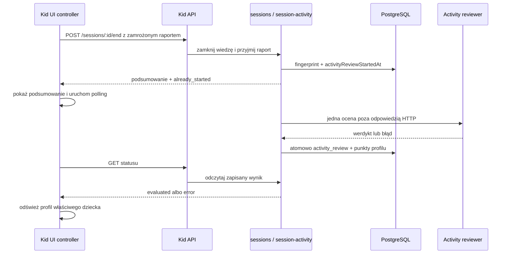

# Phase 1: Asynchroniczne kończenie sesji i naliczanie punktów - Research

**Researched:** 2026-10-21  
**Domain:** asynchroniczne przyjęcie raportu aktywności sesji, trwały wynik punktów i odpytywanie Kid API  
**Confidence:** HIGH

<user_constraints>
## User Constraints (from CONTEXT.md)

### Locked Decisions

### Dostępność podsumowania i komunikat o punktach
- **D-01:** Po zakończeniu sesji ekran podsumowania pojawia się bez oczekiwania na werdykt LLM. Pozostałe treści i działania na ekranie są dostępne podczas oczekiwania.
- **D-02:** W miejscu wyniku punktowego dziecko widzi krótki, zrozumiały komunikat, że punkty są jeszcze liczone. Spinner nie jest wymagany; konkretny wizualny wskaźnik i tekst może dobrać projektant/implementujący zgodnie z istniejącym stylem Umiem!.
- **D-03:** Po wyniku pojawiają się naliczone punkty albo istniejący komunikat o błędzie naliczenia; awaria oceny nie przyznaje punktów.

### Asynchroniczny wynik
- **D-04:** Klient używa krótkiego odpytywania statusu (polling), aby wykryć zakończenie oceny.
- **D-05:** Sprawdzanie trwa również po opuszczeniu podsumowania lub zmianie profilu. Wynik aktualizuje licznik punktów profilu dziecka, którego sesja została oceniona.
- **D-06:** Wynik pozostaje możliwy do odczytania po odświeżeniu lub powrocie do aplikacji; klient nie może uzależniać jego dostępności wyłącznie od stanu komponentu podsumowania.
- **D-07:** Zachować istniejącą zasadę pojedynczej oceny na sesję, brak automatycznych ponowień i brak punktów przy błędzie technicznym. Stan asynchroniczny nie może ponownie naliczyć punktów przy powtórzonym żądaniu.

### the agent's Discretion
- Dobór krótkiego tekstu oczekiwania i nieblokującego wskaźnika wizualnego.
- Interwał i strategia backoff pollingu oraz jego obsługa przy chwilowej utracie sieci, o ile nie blokują ekranu i pozwalają odzyskać zapisany wynik.
- Kształt kontraktu statusu i endpointu po analizie istniejących granic i zabezpieczeń.

### Deferred Ideas (OUT OF SCOPE)

None — discussion stayed within phase scope.
</user_constraints>

## Summary

Obecne opóźnienie ma jedno źródło: `endSession()` najpierw zamyka wiedzę, a potem oczekuje na `reviewSessionActivity()`, która wykonuje wywołanie dostawcy LLM przed zwróceniem podsumowania. [VERIFIED: `packages/server/src/modules/sessions.ts:1413-1425`] W efekcie kontroler Kid UI czeka na całe żądanie zanim ustawi ekran podsumowania. [VERIFIED: `packages/kid-ui/src/session/session-controller.ts:668-717`]

Najmniejsza zgodna zmiana to rozdzielenie szybkiego, transakcyjnego przyjęcia raportu od wykonania oceny oraz udostępnienie odczytu już zapisanego statusu przez Kid API. Stan trwały i atomowe naliczenie punktów już istnieją: wynik trafia do `learning_sessions.activity_review`, a profil i sesja są blokowane w jednej transakcji finalizacji. [VERIFIED: `packages/server/src/modules/session-activity.ts:503-570`] Nie potrzeba nowej kolejki, Redisa, mikroserwisu ani nowej tabeli.

**Primary recommendation:** zachować obecny rekord oceny i jego blokady; dodać status `already_started` do szybkiej odpowiedzi końca sesji, uruchamiać jedyną ocenę poza krytyczną ścieżką odpowiedzi HTTP, a Kid UI zasilać odczytem statusu przez kontroler, także po zmianie ekranu lub profilu.

## Architectural Responsibility Map

| Capability | Primary Tier | Secondary Tier | Rationale |
|---|---|---|---|
| Przyjęcie raportu i uruchomienie pojedynczej oceny | API / Backend | Database / Storage | Serwer waliduje raport, zapisuje fingerprint i znacznik rozpoczęcia pod blokadą sesji. |
| Trwały wynik i punkty | Database / Storage | API / Backend | Finalizacja zapisuje rekord i zwiększa punkty profilu atomowo. |
| Odczyt postępu oceny | API / Backend | Browser / Client | Endpoint zwraca wyłącznie publiczne DTO; klient nie wnioskuje o wyniku z czasu oczekiwania. |
| Polling, odświeżenie profili i prezentacja | Browser / Client | API / Backend | Kontroler jest jedynym miejscem trwałym przez zmianę widoków; komponent podsumowania pozostaje prezentacyjny. |

## Standard Stack

### Core

| Element | Wersja / źródło | Purpose | Why Standard |
|---|---|---|---|
| istniejące kontrakty Zod `@learning/contracts` | workspace | publiczne DTO, walidacja odpowiedzi Kid API | Kontrakty są wspólną granicą serwer-klient i już walidują odpowiedzi. |
| `LearningSessionController` | istniejący Kid UI | cykl sesji, retry i aktualizacja profili | Przetrwa przejście między podsumowaniem, listą zestawów i profilem. |
| `session-activity.ts` | istniejący moduł serwera | przyjęcie raportu, jednorazowa ocena i atomowa finalizacja | Posiada już fingerprint, timeout oraz blokady. |

### Supporting

Brak nowych zależności. Faza jest zmianą wewnętrznego przepływu i publicznego DTO/API, bez instalacji pakietu.

## Project Constraints (from AGENTS.md)

- Nie wypychać bezpośrednio do `main` i nie scalać PR bez polecenia właściciela.
- Kod, DTO i endpointy po angielsku; dokumentacja oraz komunikacja po polsku; teksty Kid UI utrzymywać w współdzielonym katalogu komunikatów.
- Kid UI używa wyłącznie jawnego `/api/v1/kid`, konfigurowalnego `baseUrl` i nie importuje Next.js, serwera ani bazy.
- Nie dodawać mikroserwisów, Redisa, osobnego backendu ani przedwczesnych abstrakcji.
- SDK i wywołania dostawców pozostają za portem; dziecko nie dostaje klucza odpowiedzi, technicznych score'ów ani szczegółów LLM.
- Zmiana Kid API wymaga sprawdzenia wpływu API → MCP → skill oraz testów kontraktu i standardowego klienta; jeśli wpływu nie ma, trzeba go uzasadnić.
- Dla reguł historii, współbieżności i danych stosować znaczące testy; kontrolować zegar w testach domenowych. Uruchamiać skrypty adekwatne do zmiany, po sprawdzeniu `package.json`.

## Architecture Patterns

### Istniejący przepływ i docelowe rozdzielenie

### Pattern 1: trwały stan jest źródłem prawdy

`readSessionActivityResult()` odczytuje zapisany rekord i może rozstrzygnąć osieroconą ocenę po jej terminie. [VERIFIED: `packages/server/src/modules/session-activity.ts:583-610`] Odczyt statusu ma używać tej ścieżki albo wydzielonego, równoważnego read-modelu; nie wolno go realizować przez ponowne przesłanie raportu ani lokalny timer jako dowód wyniku.

Wartości kontraktu obecnie są dokładnie: `z.enum(["evaluated", "error", "already_started"])`. [VERIFIED: `packages/contracts/src/reward-activity.ts:226-238`] Faza powinna zachować te trzy semantyki dla dziecka: naliczono, zakończono bez punktów z błędem, jeszcze liczone. Nie wyciekać `reason`, sekund, fragmentów raportu ani werdyktu modelu.

### Pattern 2: jeden akceptowany raport, jedna finalizacja

W przyjęciu raportu identyczny hash jest dopuszczony, a inny raport dla tej samej sesji kończy się konfliktem. [VERIFIED: `packages/server/src/modules/session-activity.ts:362-459`] Finalizacja sprawdza zapisany wynik pod blokadą i nie pozwala spóźnionej odpowiedzi go nadpisać. [VERIFIED: `packages/server/src/modules/session-activity.ts:503-570`] Plan ma wydzielić elementy `accept/start` i `run/finalize`, bez osłabienia tych warunków.

### Pattern 3: polling w kontrolerze, nie w widoku

Komponent `SessionActivityResultView` jest czystą prezentacją wyniku, a `KidApp` pobiera `controller.getActivityResult()` dla wszystkich trzech ekranów podsumowania. [VERIFIED: `packages/kid-ui/src/screens/SessionActivityResultView.tsx:1-15`; `packages/kid-ui/src/KidApp.tsx:105-120`] Polling powinien więc należeć do `LearningSessionController`, z identyfikatorem sesji i dziecka, ochroną `epoch` przed spóźnionym zapisem oraz odświeżeniem `#profiles` po zapisanym wyniku.

### Pattern 4: zachowanie odzyskiwania raportu

`SessionActivityDraftStore` przechowuje dokładny `finalPayload` per sesja i per dziecko przez siedem dni; jest używany do ponownego dostarczenia po utracie odpowiedzi. [VERIFIED: `packages/kid-ui/src/session/activity-draft-store.ts:12-30, 58-104`] Po pozytywnym potwierdzeniu przyjęcia raportu klient może usunąć kopię raportu, ale musi nadal znać `sessionId` dla pollingu. Plan musi oddzielić „raport zaakceptowany” od „wynik oceny gotowy”, aby nie wysyłać tego samego raportu okresowo.

## Don't Hand-Roll

| Problem | Nie budować | Użyć zamiast | Why |
|---|---|---|---|
| kolejka zadań | własnego workera, Redisa lub nowej tabeli kolejki | istniejące `activityReviewStartedAt`, rekord oceny i pojedynczy proces oceny | Zakres i architektura wykluczają nową infrastrukturę; model już ma deadline i rozstrzyganie przerwanej oceny. |
| stan wyniku klienta | licznika czasu, globalnego cache bez serwera lub stanu komponentu | trwałego `activity_review` przez endpoint odczytu | Stan musi przetrwać odświeżenie oraz zmianę profilu. |
| kolejne naliczenie punktów | osobnej arytmetyki w kliencie | `finalizeSessionActivity()` i `sessionActivityAward()` | Tylko serwer ma zablokowany profil, resztę czasu i atomowy zapis. |

## Common Pitfalls

### Polling, który ponownie uruchamia LLM

**What goes wrong:** klient używa ponownie `POST /end` jako odczytu statusu.  
**Why it happens:** obecny endpoint łączy przyjęcie raportu i ocenę.  
**How to avoid:** utworzyć jawny odczyt statusu i weryfikować, że jego wywołanie nie może wywołać providera, zmienić punktów ani aktywności.  
**Warning signs:** test fake-reviewera widzi więcej niż jedno wywołanie dla sesji.

### Utrata identyfikatora dziecka po zmianie profilu

**What goes wrong:** wynik sesji Oli odświeża aktualnie wybrany profil Antka.  
**How to avoid:** stan oczekiwania musi zawierać parę `{ sessionId, childId }`; po wyniku odświeżyć profile, ale renderować zmianę tylko, gdy odpowiada bieżącemu `epoch` i właściwemu dziecku.

### Zablokowanie podsumowania przez pobranie omówienia kartkówki

**What goes wrong:** po odblokowaniu `end` następne oczekiwane żądanie `mock-test-summary` znów opóźnia ekran.  
**How to avoid:** sprawdzić osobno słówkową kartkówkę i kartkówkę lekcji; najpierw ustawić dostępne podsumowanie, a dalsze odczyty obsłużyć bez blokowania punktów.

### Fire-and-forget bez obsługi błędu

**What goes wrong:** odrzucona obietnica oceny zostaje nieobsłużona, a sesja pozostaje rozpoczęta do deadline.  
**How to avoid:** wywołanie w tle musi przechwycić i przekształcić każdy błąd w istniejący rekord `error`, z zachowaniem jednego wywołania i bez automatycznego ponowienia.

### Kontrakt API bez kontroli MCP

**What goes wrong:** endpoint Kid API jest mylnie dodany do rodzinnego raportu lub zmienia eksportowany kontrakt Hermesa.  
**How to avoid:** udokumentować, że `learning-overview` celowo nie obejmuje punktów/oceny aktywności. Kid endpoint nie jest narzędziem MCP; jeśli nie zmienia jego DTO ani semantyki, test MCP pozostaje bez zmiany, a uzasadnienie trafia do summary/PR.

## API and MCP Boundary

Nowy odczyt statusu należy dodać do `packages/contracts`, `KidApi`, klienta HTTP oraz routera `/api/v1/kid`, z `Cache-Control: no-store` jak przy istniejących odczytach. [VERIFIED: `apps/web/src/kid/kid-router.ts:60-123`; `packages/kid-ui/src/api/KidApi.ts:27-52`; `packages/kid-ui/src/api/client.ts:63-198`]

Nie jest to część `learning-overview`: istniejący skill Hermesa opisuje czas nauki, postęp i planowane sprawdziany, a nie punkty lub ocenę aktywności. [VERIFIED: `integrations/umiem-mcp/skills/umiem-learning/SKILL.md:3-24`] Plan musi zawierać test regresji granicy i odnotować brak zmiany MCP/skill, chyba że analiza kontraktów wskaże rzeczywiste poszerzenie eksportu.

## Validation Architecture

### Test Framework

| Property | Value |
|---|---|
| Framework | Vitest `^4.1.11` [VERIFIED: `package.json:20-25`] |
| Config file | `vitest.unit.config.ts` |
| Quick run command | `corepack pnpm vitest run packages/server/src/modules/session-activity.test.ts packages/kid-ui/src/session/session-controller.test.ts packages/kid-ui/src/api/client.test.ts packages/kid-ui/src/screens/reward-summary.test.tsx` |
| Full relevant checks | `corepack pnpm test:unit` oraz `corepack pnpm typecheck` |

### Phase Requirements → Test Map

| Behavior | Test type | Automated command / location | File exists? |
|---|---|---|---|
| `POST /end` zwraca podsumowanie przed rozstrzygnięciem LLM | unit z bramką fake-reviewera | `session-activity.test.ts`, router/client test | częściowo — rozszerzyć |
| status nie uruchamia drugiej oceny ani nie nalicza drugi raz | unit domeny z fake-reviewerem i kontrolowanym zegarem | `session-activity.test.ts` | rozszerzyć |
| podsumowanie jest widoczne podczas oczekiwania i potem aktualizuje punkty | unit kontrolera i widoku | `session-controller.test.ts`, `reward-summary.test.tsx` | rozszerzyć |
| polling po zmianie profilu aktualizuje właściwy licznik | unit kontrolera z dwoma profilami i kontrolowanym pollingiem | `session-controller.test.ts` | rozszerzyć |
| publiczny status jest walidowany klientem i endpointem | klient/router test | `client.test.ts`, `kid-router` test | dodać/rozszerzyć |
| MCP nie eksportuje punktów/werdyktu | regresja kontraktu | `test:mcp` lub celowany test integracji | istnieje — uruchomić jeśli DTO MCP się zmieni |

### Wave 0 Gaps

Brak nowych frameworków lub fixtures. Pierwszy plan powinien rozszerzyć fake provider/gates w istniejących testach, z realnym RED dla oczekiwanej nieblokującej odpowiedzi.

## Security Domain

| ASVS Category | Applies | Standard Control |
|---|---|---|
| V3 Session Management | yes | `sessionId` przechodzi przez walidację UUID i istniejącą blokadę sesji. |
| V4 Access Control | yes | ten sam Kid API model i kontrola same-origin dla mutacji; status zwraca jedynie publiczne DTO. |
| V5 Input Validation | yes | Zod na wejściu końca sesji i na DTO odpowiedzi klienta. |
| V8 Data Protection | yes | brak powodów modelu, sekund, raportu ani kluczy odpowiedzi w DTO dziecka. |

## Assumptions Log

| # | Claim | Section | Risk if Wrong |
|---|---|---|---|
| A1 | Uruchomienie pojedynczej obietnicy oceny po zwróceniu odpowiedzi HTTP jest akceptowalne w aktualnym procesie Next.js. | Architecture Patterns | Jeśli runtime anuluje pracę po odpowiedzi, zapisana sesja zakończy się istniejącym `review_interrupted` po deadline; potrzebna będzie decyzja o trwałym workerze, co obecna architektura i D-07 wykluczają. |

## Open Questions (RESOLVED)

1. **Czy wymagany jest spinner?** RESOLVED: nie. D-02 wymaga krótkiego komunikatu i dopuszcza decyzję implementacyjną o wskaźniku.
2. **Czy polling może ponownie wysyłać raport?** RESOLVED: nie. D-07 i istniejący fingerprint wymagają odczytu statusu bez nowego uruchomienia oceny.
3. **Czy wynik trzeba zachować po odświeżeniu?** RESOLVED: tak; źródłem prawdy jest rekord serwera odczytywany przez endpoint statusu.
4. **Czy MCP/skill Hermesa należy zmieniać?** RESOLVED: nie, o ile zmiana pozostaje wyłącznie w Kid API i nie poszerza `learning-overview`; należy to sprawdzić i odnotować.

## Environment Availability

Faza nie wymaga nowego zewnętrznego narzędzia ani pakietu. `node_modules` istnieje, a plan nie modyfikuje manifestów zależności.

## Sources

### Primary (HIGH confidence)
- `packages/server/src/modules/session-activity.ts` — przyjęcie raportu, timeout, finalizacja, blokady i idempotencja.
- `packages/server/src/modules/sessions.ts` — obecne oczekiwanie na ocenę w `endSession()`.
- `packages/contracts/src/reward-activity.ts` oraz `packages/contracts/src/kid.ts` — publiczne DTO.
- `packages/kid-ui/src/session/session-controller.ts`, `api/KidApi.ts`, `api/client.ts` — przepływ Kid UI i granica HTTP.
- `apps/web/src/kid/kid-router.ts` — routing Kid API.

### Secondary (MEDIUM confidence)
- `docs/SPEC.md` §36 i `docs/architecture.md` §21 — granice produktu: jedna ocena, brak automatycznych ponowień oraz brak punktów przy błędzie.

## Metadata

**Confidence breakdown:**
- Standard stack: HIGH — używane są wyłącznie istniejące komponenty repozytorium.
- Architecture: HIGH — ścieżka jest bezpośrednio widoczna w serwerze, routerze i kontrolerze.
- Pitfalls: HIGH — wynikają z istniejącego fingerprintu, blokad i obsługi `already_started`.

**Research date:** 2026-10-21  
**Valid until:** następna zmiana kontraktu Kid API lub `session-activity.ts`.
