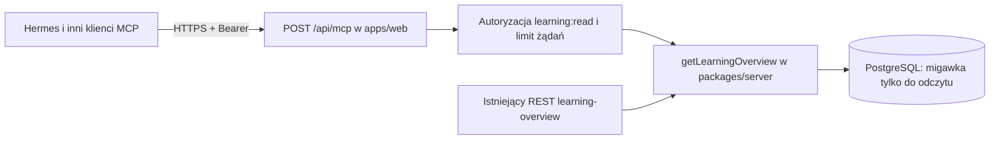

# Umiem! MCP Streamable HTTP w apps/web — projekt

Data: 2026-10-12. Status: kierunek zatwierdzony; specyfikacja i plany przygotowane wspólnie na wyraźne polecenie właściciela. Dokumenty wymagają przeglądu przed implementacją. Przygotowanie dokumentacji nie uruchamia commita, push ani PR.

## Intencja i punkt wyjścia

Właściciel chce dodawać Umiem! do Hermesa i innych klientów jako zdalny MCP: URL HTTPS i token Bearer ze zmiennej środowiskowej. MCP ma działać w istniejącym procesie Next.js `apps/web`, wdrażanym na Coolify. Nie wymaga lokalnego procesu MCP u konsumenta ani osobnej usługi.

Dotychczasowy zakres zachowuje znaczenie danych: kilka ostatnich dni z podziałem na dni, aktualny postęp, terminy sprawdzianów i szacowany czas nauki. Zmianie podlega transport MCP i instalacja konsumenta, nie algorytm uczenia ani DTO.

Podstawa inspekcji: Knowli `fa2fcb6d485472505f7cbedc6a63670635850450`, otwarty PR #48; Hermes-szkola `48fc60f8e5989041928cd70c6c5287078af48153`. W głównym checkout Knowli są niezwiązane lokalne zmiany, których nie wolno nadpisywać. Nowe dokumenty powstają w istniejącym worktree funkcji.

## Architektura



REST `GET /api/v1/integrations/learning-overview` pozostaje dostępny. MCP wywołuje istniejący przypadek użycia bez pośredniego żądania HTTP do własnej aplikacji. SDK MCP jest zależnością wyłącznie adaptera w `apps/web`; domena, contracts i Kid UI nie importują SDK.

Implementacja używa `@modelcontextprotocol/sdk` dokładnie `1.32.1`, sprawdzonego w rejestrze npm podczas planowania, zgodnego z obecnym Zod 4. Python SDK konsumenta pozostaje w sprawdzonej linii 1.x: `mcp==1.30.0`. Celem jest interoperacyjność przez negocjację protokołu `2025-11-25` i wersji starszych obsługiwanych przez przypięty SDK. Nie implementujemy draftu ani własnego protokołu JSON-RPC. Klienci wymagający OAuth zamiast własnego nagłówka Bearer nie należą do tego zakresu.

## Transport

- Endpoint: `/api/mcp`; Next.js Route Handler, `runtime="nodejs"`, `dynamic="force-dynamic"`.
- `POST`: obsługa przez `WebStandardStreamableHTTPServerTransport`, `sessionIdGenerator: undefined`, `enableJsonResponse: true`. Osobny `McpServer` i transport dla każdego żądania; brak globalnego tokenu, principal lub sesji MCP.
- Wspierane: `initialize`, `notifications/initialized`, `ping`, `tools/list`, `tools/call` zgodnie z SDK. Brak sampling, elicitation, zasobów i promptów.
- `GET`, `HEAD`, `DELETE`, `PUT`, `PATCH`, `OPTIONS`: po kontroli Origin i tokenu zwracają 405, `Allow: POST`; bez uwierzytelnienia 401. Nie otwieramy stałego strumienia SSE ani endpointu starego HTTP+SSE.
- Każda odpowiedź ma `Cache-Control: no-store, max-age=0` i `X-Request-Id`. Brak `Mcp-Session-Id`; odpowiedź narzędzia jest JSON, co jest dopuszczonym trybem Streamable HTTP.
- SDK odpowiada za negocjację, Content-Type/Accept, nagłówki wersji, kody błędów protokołu i 202 dla poprawnych powiadomień. Nieobsługiwana wersja w żądaniu po inicjalizacji daje 400.
- Jeden komunikat JSON-RPC na POST. Tablica/batch jest odrzucana; maksymalnie 16 KiB body, liczone również przy braku lub fałszywym Content-Length. Przekroczenie daje 413 przed parsowaniem całej treści.
- Po zakończeniu lub błędzie zamykamy serwer i transport; przy JSON zamknięcie następuje po utworzeniu gotowej odpowiedzi. Rozłączenie klienta nie może pozostawić otwartego transportu. Zapytania PostgreSQL zachowują istniejący `statement_timeout=8000ms`; nie deklarujemy, że anulowanie HTTP automatycznie anuluje SQL.

## Narzędzie i kontrakt

Dokładnie jedno narzędzie: `umiem_get_learning_overview`. Argumenty pochodzą z `LearningOverviewQuerySchema`: `days` 1–31/dom. 7, `upcomingTestDays` 1–90/dom. 14, opcjonalny UUID `childId`. Brak argumentu URL/token, nieznanych pól ani konwersji stringów/bool na liczby.

Wynik: istniejący `LearningOverviewDto`, `schemaVersion: 1`, jako `structuredContent` oraz jeden element tekstowy z tym samym JSON dla klientów bez obsługi structuredContent. `outputSchema` eksportowany z tego samego kontraktu; wykonanie waliduje także reguły semantyczne, których JSON Schema nie potrafi przedstawić. Adnotacje: read-only, niedestrukcyjne, idempotentne.

Zachowujemy 7/14 dni domyślnie, strefę rodziny, osobne UUID dzieci, wersje zestawów, czas `estimated=true`, `null` przy braku podstaw do oszacowania, częściowy dzień dzisiejszy, `pendingAttempts` jako podzbiór `submittedAttempts` oraz `skipped`/`unassessed` jako podzbiory `notTested`.

DTO po kodowaniu UTF-8 może mieć maksymalnie 2 MiB; pełna odpowiedź HTTP z dwoma reprezentacjami maksymalnie 4 MiB. Przekroczenie nie obcina danych i nie tworzy pustego sukcesu: zwraca jawny błąd narzędzia. Test obejmuje dodatkowe powiększenie przez escapowanie tekstu JSON.

## Autoryzacja i granice

- Każdy request, również inicjalizacja/lista/ping/powiadomienie, wymaga `Authorization: Bearer <umiem_token>`; wykorzystujemy istniejący token `learning:read`, hash, możliwość odwołania i CLI. Cookie rodzica lub dziecka nie zastępuje tokenu MCP.
- Brak/błędny/odwołany token: HTTP 401 z `WWW-Authenticate: Bearer`; brak scope: 403. Błąd połączenia z bazą podczas kontroli tokenu: 503. Treść transportowa jest bezpiecznym błędem JSON-RPC z `id: null`; nie używamy REST DTO błędu jako odpowiedzi MCP.
- Granica HTTP uwierzytelnia przez `requireLearningReadToken`; wykonanie narzędzia ponownie sprawdza token w istniejącej transakcji `REPEATABLE READ READ ONLY`. Odwołanie po initialize blokuje późniejsze wywołanie. Nie opieramy autoryzacji na handshake ani przechowanym principal.
- REST i MCP dzielą jeden `IntegrationReadLimiter`: 60 żądań na token w 60 s na proces web. MCP liczy każdy uwierzytelniony request raz, bez drugiego naliczenia w use case. 429 zawiera `Retry-After`. Ograniczenie jest procesowe, tak jak obecne REST; nie dokładamy Redis ani nie obiecujemy limitu globalnego przy wielu replikach.
- `UMIEM_MCP_ALLOWED_ORIGINS`: lista pełnych originów HTTPS rozdzielona przecinkami. Domyślnie pusta: brak Origin akceptowany dla klientów serwerowych, każdy obecny Origin odrzucany. Na liście: porównanie dokładne; `null`, wildcard, błędny Origin i nieznany origin -> 403 przed odczytem body. Nie włączamy CORS dla przeglądarki w tym zadaniu.
- HTTPS kończy istniejący proxy Coolify. Adapter nie ufa dowolnemu `X-Forwarded-Host` ani nie tworzy originów z nagłówków klienta. Nie zmieniamy dostępu spoza domu podczas lokalnej implementacji.
- Token, body RPC, private DTO i wyjątki z taką treścią nie trafiają do logów. Błędy domeny w `tools/call` dają `isError=true`, krótki code/message/retryable/requestId, bez pustego podsumowania. Błędy protokołu obsługuje SDK.

## Konfiguracja Hermesa

```yaml
mcp_servers:
  umiem:
    url: "https://umiem.example/api/mcp"
    headers:
      Authorization: "Bearer ${UMIEM_READ_TOKEN}"
    timeout: 30
    connect_timeout: 10
learning:
  enabled: true
  consumer_root: "/opt/data/school-agent/umiem/consumers/<sourceCommit>"
```

`UMIEM_READ_TOKEN` pochodzi z chronionej konfiguracji środowiska usługi; musi być dostępny zarówno w native Hermes, jak i procesie raportera. YAML przechowuje wyłącznie referencję, nie sekret. Nie używamy pola `env` jako magazynu sekretu dla serwera HTTP. Native konfiguracja obsługuje `${VAR}` i `${env:VAR}` według aktualnej dokumentacji Hermesa; reporter rozwiązuje te dwa warianty z własnego środowiska i odmawia przy brakującej wartości. Rotacja wymaga zmiany środowiska i restartu/reconnect procesów.

`consumer_root` dotyczy tylko osobnego reportera: zawiera walidator kontraktu, schema, manifest i skill. Zwykły klient MCP potrzebuje jedynie URL i nagłówka. Pakiet konsumenta nie zawiera procesu MCP, klienta REST ani własnego venv.

## Klient raportu i wydanie

`McpLearningClient` przechodzi ze stdio na `mcp.client.streamable_http.streamable_http_client(url, http_client=...)` + `ClientSession`. Nie uruchamia subprocess, nie szuka interpretera adaptera i nie potrzebuje `adapter_root`. Timeout 30 s obejmuje initialize, jedno wywołanie narzędzia i cleanup; HTTP timeout wynosi 10 s. Brak automatycznego ponowienia tools/call w reporterze.

Klient akceptuje HTTPS; HTTP loopback tylko z jawną flagą procesu testowego `UMIEM_ALLOW_LOOPBACK_HTTP_FOR_TESTS=1`. Odrzuca userinfo, query i fragment w URL oraz przekierowania, także 307/308 w obrębie tego samego origin. Nie polega wyłącznie na `follow_redirects=False`: hook odpowiedzi odrzuca 3xx przed logiką przekierowań SDK. Odpowiedź HTTP ma limit 4 MiB liczony strumieniowo, a walidator DTO 2 MiB.

Odrębny source bundle `umiem-consumer` w wersji `0.2.0` zawiera istniejący `validation.py`, pusty importowo `__init__.py`, wygenerowane schema, manifest kontraktu, SKILL.md oraz `RELEASE-MANIFEST.json` z commitami i sumami plików. Nie kopiujemy walidatora/skilla do niezależnego forka. Zależności reportera są przypięte w prywatnym runtime-deps: `mcp==1.30.0`, `httpx==0.28.1`, `jsonschema==4.26.0`, `tzdata==2026.5`; istniejące tiktoken/PyYAML pozostają bez zmian. Globalnego środowiska Hermesa nie migrujemy.

Instalator zachowuje drift guards, owner/mode, nieznane ustawienia i inne MCP. HTTP wariant nie wykonuje `uv sync` adaptera. Weryfikuje manifest konsumenta oraz skill; native konfiguracja ma `url`/`headers`, bez `command`/`args`. Docelowo jedynym transportem MCP Umiem! jest Streamable HTTP. Usuwamy dotychczasowy Python serwer stdio, jego klienta REST, konfigurację token-file, entry point, pakowanie serwera i testy transportu stdio. Zachowujemy walidator, schema, skill oraz ich znaczące testy. Nie uruchamiamy fallbacku HTTP -> stdio/REST.

Sprzątanie Hermesa obejmuje stare pola command/args/env adaptera, adapter_root, interpreter discovery, staging i tworzenie venv. W tym czacie niczego nie wdrożono live, więc nie zakładamy, że istnieje produkcyjna instalacja stdio. Jeżeli podczas późniejszego wdrożenia znajdziemy taką instalację, usuwamy lub archiwizujemy wyłącznie jej pliki wskazane manifestem po potwierdzeniu HTTP; bez naruszenia innych MCP, notatek i receipt. Ukończone wcześniejsze dzienniki pozostają zapisem historii prac, nie instrukcją bieżącej instalacji.

Evening nadal wykonuje jedno pobranie przed generacją tekstu. Morning/Sync nie pobierają Umiem!. Kontekst zachowuje limit 4000 tokenów i istniejące reguły kompaktowania. Disabled/unavailable oraz receipt idempotency pozostają bez zmian.

## Granice wdrożenia i ukończenia

Implementacja kończy się lokalnymi testami protokołu, PostgreSQL, E2E Next.js, reporterem HTTP na syntetycznych danych, instalatorem fake-root oraz niezależnym review całego zakresu. Dopiero potem aktualizacja/utworzenie PR z implementacją; żadnego scalania bez polecenia właściciela.

Live Coolify, wydanie tokenu, native profile/skill registry, proces usługi i naturalny Evening wymagają osobnego wdrożenia. Ich sprawdzenia nie są zastępowane testem root, samym GET REST ani sztucznym `cron run`. Rollback wyłącza `learning.enabled` i usuwa wyłącznie elementy wskazane manifestem; nie odtwarza starych rodzinnych notatek.

## Źródła techniczne sprawdzone podczas planowania

- [Specyfikacja transportu MCP 2025-11-25](https://modelcontextprotocol.io/specification/2025-11-25/basic/transports): standard HTTP, JSON/SSE, negocjacja i Origin.
- [Oficjalny transport TypeScript SDK v1.x](https://github.com/modelcontextprotocol/typescript-sdk/blob/v1.x/src/server/webStandardStreamableHttp.ts): Fetch Request/Response, tryb JSON i instancja per request.
- [Metadata wydania SDK 1.32.1](https://registry.npmjs.org/@modelcontextprotocol%2Fsdk/1.32.1): stabilny pin i zgodność Zod; gitHead `ff07b001194fe60ee9deb2121cf119057565796d`.
- [Oficjalna konfiguracja MCP Hermesa](https://github.com/NousResearch/hermes-agent/blob/main/website/docs/reference/mcp-config-reference.md): url, headers i referencje środowiskowe; nie jest dowodem wersji zainstalowanej na hoście.
- [Oficjalny klient Python](https://github.com/modelcontextprotocol/python-sdk/blob/v1.x/src/mcp/client/streamable_http.py): przekazywanie httpx klienta. Sygnaturę potwierdzono lokalnie na zainstalowanym `mcp==1.30.0`.
